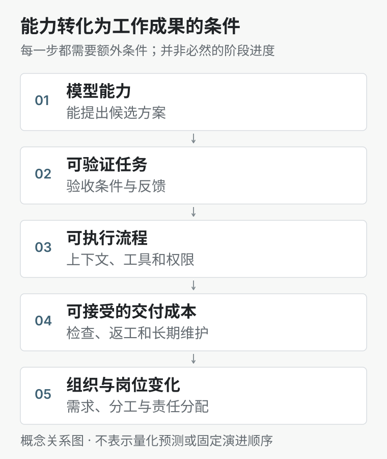
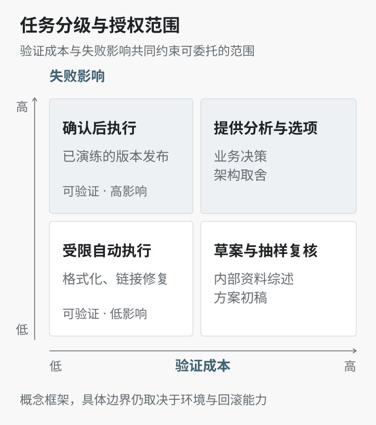

# 关于 AI：工作重组与工程师的选择

最早使用 ChatGPT 时，让我感到新鲜的并不只是回答速度。以前学习一个问题，要先搜索、筛选，再把不同文章拼起来；现在可以直接讨论，追问不理解的地方，要求换一种解释。获取知识第一次有了接近对话的体验。

此后，每次模型更新、编程工具升级，或者出现新的 Agent，我都会重新经历一遍兴奋与焦虑。兴奋来自它确实能帮我解决问题；焦虑则来自另一个方向：如果它越来越擅长我的工作，我还需要掌握什么？

第一次写这篇文章时，我给自己的答案是：少被新闻牵着走，把 Go 和后端基础学扎实，AI 的基础设施与应用总还需要工程师。现在再看，前半句仍有价值，后半句却不足以支撑职业判断。**一项技术仍被需要，与完成相关工作需要多少人，是两个问题。**

这次修订，我想保留那些真实的使用经历，同时重新审视原先用来缓解焦虑的推论。文中资料核查截至 2026 年 10 月 30 日；涉及未来工作形态的内容属于情景推演，不是时间表或确定预测。

## 1. 工具采用与真实需求

有一次，我安装了 OpenClaw，接好模型接口，然后坐在电脑前想了很久：接下来让它做什么？

写代码已有相对顺手的工具，深入学习和资料调研也有自己的方式。新的助手看起来能连接更多东西，但我暂时没有一个反复发生、值得交给它的任务。最后，我没有继续配置。

这件事让我意识到，安装一个工具与改善一项工作之间，还缺少具体的任务定义。一个演示可以证明某种能力存在，却不能直接证明它适合我的工作。我需要知道输入是什么、结果怎样验收、执行频率有多高，以及出错后要花多少时间处理。

类似的事情也发生在自建知识库上。我尝试过 Ollama 与向量数据库，后来看到 Gems 等产品能满足部分相近需求，就停止了继续搭建。当时觉得是自己没坚持下来，也觉得产品更新太快，个人尝试很容易失去意义。

现在看来，需要区分两个目标：如果目标是方便地使用自己的资料，成熟产品可能已经足够；如果目标是理解检索、数据更新和权限隔离，自建过程仍有学习价值。Gems 支持自定义指令及知识文件，但这不意味着它与任意自建知识库在数据接入、检索控制和部署方式上等价。[Google：Gems 的指令与知识文件](https://support.google.com/gemini/answer/15235603?hl=en)

我也曾把 AI 的热度与 2018 年的区块链热潮联系起来。这个类比可以提醒我留意技术之外的营销和资本叙事，却不能据此判断两者会有相同结局。对具体工具的判断，仍应回到它完成了什么工作、实际成本是多少。

没有明确需求时暂缓采用，是一种资源分配；有明确需求时仍因抵触变化而拒绝试用，则可能错过收益。值得保留的是这两者之间的判断能力。

## 2. 模型能力与交付能力

讨论 AI 时，“会做一道题”“能完成一个任务”“能够承担一份工作”经常被混在一起。三者相关，但需要的条件并不相同。

模型能提出正确方案，只是起点。真实任务还需要有效上下文、可用工具、合适权限和反馈渠道；稳定交付又涉及异常恢复、维护成本及责任划分。AI 可以参与其中的多个环节，但每增加一个环节，都需要新的验证依据。

*图 1：能力转化为工作成果的条件。该图表示条件关系，不代表行业必然按顺序经历的发展阶段。*

### 2.1 基准测试的含义与范围

我会继续关注能力评测，但需要看清指标究竟测量了什么。

例如，METR 的任务时间跨度使用人类专家完成任务的耗时衡量任务难度，再估计 Agent 在给定成功率下能处理的范围。它并不是“AI 可以连续无人值守工作多久”。50% 成功率与更高可靠度也不能混为一谈，其任务集主要是要求明确、可自动评判的软件任务。[METR：任务完成时间跨度，更新于 2026 年 9 月 8 日](https://metr.org/time-horizons/)

一个模型能完成原本需要数小时的任务，意味着能力边界发生了变化。要把这个结果用于实际系统，还需要说明失败代价、重试成本、上下文差异和验收标准。对于草稿生成，偶尔失败可能只意味着重新尝试；对于数据变更，同样的失败率可能无法接受。

### 2.2 效率应以完整任务衡量

“感觉更快”也需要验证。METR 在 2025 年的一项研究中，让 16 位熟悉相关开源项目的开发者处理 246 个真实任务，发现使用当时的 AI 工具后，完成时间平均增加了 19%。这描述的是特定时期、工具与任务条件下的结果，不能推广为所有开发工作的结论。[METR：2025 年开发者效率研究](https://metr.org/blog/2025-07-10-early-2025-ai-experienced-os-dev-study/)

到 2026 年 2 月，研究者在后续更新中认为工具可能已经带来更多提速，但参与者不愿进入无 AI 组等选择效应，以及并行使用多个 Agent 的计时问题，使提速幅度难以可靠估计。旧结论不能无限沿用，新结论也不能仅凭使用者的感觉确定。[METR：后续实验设计调整](https://metr.org/blog/2026-02-24-uplift-update/)

这对我的启发是，要把计时终点放在“任务被接受并能正常使用”，而不是“模型生成完毕”。代码写得快，可以同时伴随更多审查；一次实现更快，也可能留下之后才出现的维护工作。

对于个人实践，我会同时记录人工投入、任务完成的日历时间、工具费用和返工次数。把模型等待时间与人的操作时间分开，也能避免把并行带来的收益算错。生成速度当然有价值，但它只是完整成本的一部分。

## 3. 技术需求与岗位需求

原文里有两种安慰自己的说法，现在需要重新检验。

第一种是：AI 需要服务器、Kubernetes、后端接口，所以熟悉 Go 就不容易失去工作。

这些系统可能继续存在，维护它们的方式却会改变。如果同样的需求可以由更少的人完成，技术栈没有消失，相关岗位数量和招聘标准也可能变化。反过来，开发成本降低，原本不值得做的软件也可能变得值得做，从而形成新需求。两种效应可以同时发生，哪一种占主导，需要观察，不能仅从技术依赖关系推出结论。

第二种是：自动化总需要人来建设和验收，所以人不会被替代。

建设自动化确实包含人的工作，但其中的任务也可能继续自动化。今天需要人工提供上下文，明天可能由系统从仓库和历史记录中整理；今天需要逐项检查，明天可能由更好的测试和模型辅助完成。“目前还需要人”描述的是当前分工，无法保证这种分工长期不变。

### 3.1 任务暴露不等于岗位替代率

原文把一些研究概括成“工种替代率”，这个用词不够准确。Anthropic 在 2026 年 3 月的研究中结合理论能力与平台使用情况衡量任务暴露，并分析美国劳动力数据；它没有观察到高暴露职业失业率的系统性上升，但发现年轻劳动者进入这些职业的招聘可能放缓。后者属于初步证据，不能直接当作确定的因果结论，也不能代表中国或全球就业状况。[Anthropic：AI 的劳动力市场影响](https://www.anthropic.com/research/labor-market-impacts)

ILO 同年 4 月的说明进一步区分了技术暴露与就业结果：能够影响多少现有任务，并不直接回答企业是否会采用、采用是否划算，以及工资、需求和组织分工如何调整。[ILO：AI 暴露指标的含义与局限](https://www.ilo.org/publications/workers%E2%80%99-exposure-ai-what-indicators-tell-us-%E2%80%93-and-what-they-don%E2%80%99t)

因此，一份报告既不能告诉我“你有某个百分比的概率失业”，也不能因为尚未观察到显著失业，就证明岗位没有风险。岗位变化还可能表现为停止扩招、提高入门门槛，或者把更多职责交给现有人员。这些是需要分别核查的变化，不能由一个暴露分数代替。

### 3.2 工程基础的价值需要重新表达

我仍然愿意继续学习 Go、并发、数据库和分布式系统，但理由需要更具体。

例如，AI 生成一个异步任务实现，我需要判断它是否把请求超时当成执行失败，是否在数据库提交前就发送消息，是否在任务重试时重复产生业务效果。理解这些问题，有助于提出约束、设计实验和解释故障。这种价值来自对系统行为的掌握，和手工写了多少行代码没有必然关系。

不过，审查、架构和业务理解也不应被划成永久属于人类的领域。AI 同样会参与这些环节。我更愿意把基础知识看作参与更复杂工作的条件：它帮助我判断依据、修改方法，并在工具给不出可靠答案时继续处理问题。

## 4. 三种可能的工作形态

以下推演不依赖某一年出现“全能 AI”。我更关心的是：如果执行能力继续提高、使用成本逐步下降，而可靠性仍然有边界，工作会怎样重组。

### 4.1 维护长期状态的个人代理

我对个人助手的期待，已经超出了多开几个聊天窗口。

一种可能的形态是，代理围绕长期目标维护状态：知道哪些资料已经核查，哪些决定仍然有效，哪个任务被什么条件阻塞，以及下一步可以在什么权限内执行。它能够在不同工具之间延续一项工作，暂停之后仍能恢复，不需要每次从头解释。

以这个博客为例，助手可以定期识别引用失效、版本变化和论据不足的文章，查阅新资料，提出修订，再运行构建检查。更进一步，它可以根据我长期的学习方向整理待验证问题，帮助形成下一篇文章的研究材料。这里的目标是持续维护知识，而非持续制造文章。

这种代理需要的记忆也不能只是对话越存越多。过期偏好要能撤销，事实与猜测要分开，资料需要来源和时间，执行任务需要预算与停止条件。能够读邮件，也不意味着可以替我承诺；能够改文件，也不意味着可以自行发布。

权限判断本身已经成为 Agent 系统设计的一部分。Anthropic 在 2026 年的工程说明中，将输入侧提示注入识别与动作侧授权判断分开处理，并讨论自动判断的局限。它可以说明设计问题的具体性，但不能作为所有 Agent 已经可靠的证据。[Anthropic：自动权限模式的设计](https://www.anthropic.com/research/claude-code-auto-mode)

我会用一个很朴素的信号判断这类系统是否值得采用：同一项任务交给它之后，我需要重新解释、纠错和接管的频率，是否随着使用而下降。如果使用时间越长，监督负担反而越大，那么“长期助手”还没有形成实际收益。

### 4.2 按任务生成的短期软件

另一种可能是，部分软件不再值得作为长期产品维护。

一次数据整理、一个短期项目的内部界面、一份只需要运行几次的分析工具，都可能根据明确需求直接生成。过去开发和交接成本过高的小需求，会获得可用的实现。软件数量可能因此增加，但其中相当一部分只服务于特定任务。

在这个情景下，需要长期保存的内容可能包括数据定义、业务规则、接口契约和验收样例。一些实现可以替换，约束和验证依据则需要延续。团队不必对每段临时代码投入相同维护成本，却必须知道什么可以重建，什么关系到长期兼容。

这并不意味着代码可以随意丢弃。只要工具接触真实数据、影响他人工作，依赖版本、运行记录和可复现性仍然重要。数据丢失不会因为界面可以重新生成而自动恢复。长期运行、错误代价高、参与方多的系统，也很难仅靠一次生成完成治理。

我认为这里可能出现的机会，是为某一类具体业务提供“可生成但可约束”的工具：输入格式清楚、权限范围有限、结果能够核验，必要时可以重建。这比再做一个没有特定使用场景的通用聊天入口，更容易判断价值。

### 4.3 小团队扩张与培养路径收缩

如果一个工程师可以同时组织多个有明确边界的执行任务，小团队可能承担过去更大的交付范围。需求澄清、实现、检查和运行之间的等待有机会缩短，一些过去需要跨多个人交接的工作可能集中到较少的人手中。

但这里有一个我不愿忽略的矛盾：能够独立判断复杂系统的人，往往经历过大量看似普通的练习。修小问题、补测试、读旧代码、处理一次线上异常，都是形成判断力的过程。如果这些入口任务大量交给 AI，新人如何获得承担复杂任务的经验？

“以后大家都去审查 AI”没有回答这个问题。没有做过设计、定位和修复，审查很容易只剩下确认语气是否自信、测试是否显示绿色。

一种务实的调整，是把培养过程设计得更明确：让新人先提出假设，再比较模型方案；在隔离环境中复现故障；对同一问题给出不同实现，并解释取舍；对模型建议保留反例测试。工具可以降低练习环境的构建成本，但学习者仍需要亲自作出判断并接受反馈。

这个情景既可能带来更高个人产出，也可能减少部分招聘需求。新增软件需求能否吸收这种变化，收益如何在使用者、公司和平台之间分配，都不会由技术进步自动决定。我没有充分依据给出乐观或悲观的单一答案。

## 5. 个人实践的取舍

这些推演需要落实到可检验的小范围实践，否则很容易形成另一种技术想象。

### 5.1 按任务分配自主权

我不会只按模型品牌决定交给它多少工作。任务是否容易验证、失败影响多大、能否恢复，同样重要。同一个工具，在修复文档链接和修改生产数据时，适合的授权范围可以完全不同。

*图 2：任务分级与授权范围的定性框架。示例位置用于说明判断方式，实际授权还需考虑数据敏感性、运行环境和回滚能力。*

这张图也不是固定的人机分工表。测试工具、沙箱和业务规则更完善之后，一项任务的验证成本可能下降；进入生产环境之后，它的失败影响又可能增加。授权需要随具体条件调整。

对于高影响任务，人工确认也只是一个环节。备份、回滚、最小权限和可追踪的执行记录，决定了确认之后仍然存在多少风险。

### 5.2 用两周验证一个持续需求

如果只选一件事，我会先尝试让 AI 协助维护这个博客，而不是继续收集助手工具。计划限定为两周，选取范围相近的文章做人工与 AI 辅助的交替检查，不在同一篇文章上简单重复比较，以减少熟悉内容带来的干扰。

| 任务 | 可核验的结果 | 需要记录的成本 |
| --- | --- | --- |
| 检查链接与站内锚点 | 给出位置、响应或缺失目标 | 误报处理时间、遗漏情况 |
| 核查版本相关论断 | 原文、当前一手资料及适用日期对应 | 阅读来源与判断相关性的时间 |
| 提出内容修订 | 修改有来源，保留原意与个人经历 | 审查、返工和纠正新增错误的时间 |
| 验证发布准备 | 构建通过，图片与跳转正常 | 工具费用、等待时间及恢复成本 |

实验中只生成候选修订，发布由我确认。验收标准在执行前确定，不能因为 AI 给出了一个完整答案，就临时降低要求。

我会同时看完成时间、人工投入、漏检、误改和一周后仍需返工的内容。两周的小样本只能帮助选择自己的工作方法，不能证明普遍生产率。如果没有稳定收益，就缩小任务范围或停止自动化。

### 5.3 保留独立形成判断的过程

最近一项研究让我对“最后由人确认”有了更具体的疑问。Anthropic 于 2026 年 10 月 27 日公布的实验，在统计分析任务中人为设置 Agent 的建议倾向，观察到专业分析人员的判断会随之改变。研究只覆盖特定任务、模型和实验条件，不能直接外推到所有专业工作，但它提示：签字确认未必意味着形成了独立判断。[Anthropic：Agent 对专家判断的影响](https://www.anthropic.com/research/agents-judgment-calls)

这对我的使用方式有一个直接要求：在重要问题上，先写下自己接受结论的依据，以及什么证据会让我改变意见，再让 AI 提供分析。对它给出的结论，要能追溯到原始资料、运行结果或可复现过程。

多开一个 Agent 交叉检查可以增加发现问题的机会，但几个模型给出相同说法，并不自动构成独立证据。如果共享错误前提，它们也可能一致地得出错误结论。

我希望继续学习基础知识，也希望把重复劳动交出去。这两件事可以同时进行。判断自己是否进步的一个办法，是关掉对话窗口之后，能否独立解释关键取舍，能否指出方案失效的条件，并在出现问题时知道从哪里查起。

## 6. 不确定性与选择

我仍然期待 AI 继续变强。更好的工具意味着更多想法可以被尝试，也意味着个人能够进入过去因时间、知识或实现成本而放弃的领域。

与此同时，我不再把“总还需要人”作为职业安全的保证。岗位名称可能保留，任务组成、人数和回报方式却发生变化；新工作可能出现，也不一定由原来的劳动者顺利承接。个人需要调整，团队也需要为学习、迁移和责任承担留出资源。

对我而言，下一步可以很具体：选择一个持续存在的问题，明确验收方式，允许工具完成更多工作，并记录它到底省下了什么、又增加了什么。工具不合适时更换工具，原有判断不成立时修改判断。至于长期会走到哪里，我愿意保留想象，也愿意让实际结果修正这种想象。
