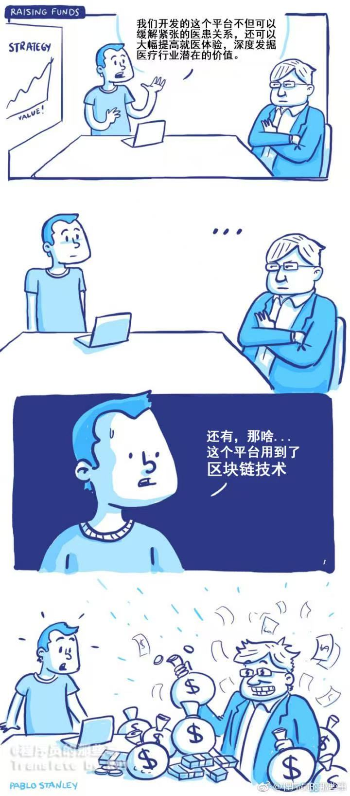

为什么想聊聊ai呢？主要实在是太火了，火到回家我妈都问我最近的ai是什么回事了。我是从chatgpt-3模型发布开始使用的，当时确实让我眼前一亮，感叹这玩意太神奇了，我不用去google和垃圾csdn去主动搜索知识内容就可以解决问题了。而且，那种眼前一亮不仅仅是现在，出来个新版本的模型又跑了多少分，或者又出来个agent能够相互协调自动化做了多少事情。是那种从0到1的全新体验，我可以有一个类似于和人讨论问题的方式去解决问题。

但是最近我有回归于平常了，虽然ai依然火爆，尤其是各种新闻，比如今天又发布了一个ai引起的死亡螺旋式失业和经济问题、又是openclaw做智能助手完全可以代替人工、还有Anthropic出了关于ai的工种替代率的文章等，不同新闻对我的吸引力和心态的影响当然会有不同，也会焦虑，考虑啥时候会被ai替代，那还干个屁的程序员呢？又会闲的蛋疼的担心这个担心那个？沉下心来想一想，我们确实要去拥抱ai这毋庸置疑，因为它确实提效了，至少在学习、编程上带来的效率提升确实很大。但是，这是一个需要时间的过程，当前的ai有点像但又不完全是，18年那会儿区块链爆火的日子，我现在手机里还有一张图，如下：

虽说不完全一样，但是有那么点味了。openclaw最近实在是太火了，那天我也忍不住下载下来，想尝试一下，但是在将其连接上我的gemini api后，我就坐在电脑前想“我可以用它来做点啥呢？”，平时写代码我直接用claude code或者是codex，它们能够很好的帮助我去解决问题，假如想做一些知识的深入学习或者调研报告，我也是直接用gemini，那现阶段我用openclaw可以解决什么需求呢？想了半天，发现没有。于是我就没继续进行，因为我不想因为这东西吸引了我的“注意力”，而陷入一种“拿锤子找钉子”的过程。

在ai发展的每个阶段，我都曾陷入过这个状态。刚开始的时候，流行基于大模型建自己的知识库，当时想既然这么火，不如就作为学习ai的一个途径尝试自己去搭建，搞了什么ollama + 向量数据库去做自己的知识库，当然是失败了，自驱力差是一部分原因，还有就是ai发展太快了，后来我发现gemini推出了所谓gems完全和我要搭建的这一套类似，就没有再费心去做。再后来deepseek又大火，对我的冲击还是很大的，我在想不行转ai开发？看看go开发是否有比较可以和其结合的点呢？当然没有成功，一是没有那么迫切的需求逼着自己；二是，我在想，ai现阶段向下需要部署在服务器上，那现在最流行的就是k8s那一套基建，k8s的go岗位需求很大，我将go搞精通了，自然不会落到没活可干，向上ai本质还是要有一个载体向外输出服务，无论这个载体是web、app或者其他什么形式，那其本质还是需要go开发的。所以，我就没那么焦虑，至少不会再被各种爆炸性的ai新闻牵着走了。

我也理解当前ai的新闻频频吸引大家的注意力不仅仅是其本身的提高生产力的能力优势，更多的还有经济学、社会学及国家政治等方方面的原因。对于我而言就是要分辨其是否对你有直接影响，这个影响本身是好是坏。其实我每次都很期待大模型的升级的，因为其确实更智能了，而且它越智能给你解决问题的能力就越强。前一阵子和朋友聊起来，后面被ai替代了怎么办？尤其是agent的发展，随着它们越来越智能，我们确实有被替代的风险。但是，我觉得无论任何事物的发展，其都需要人参与进去，即使是要替代人的ai。例如，我们要实现ai在代码设计、开发、测试、发布全流程的ai化，第一步要做什么呢？要人去调用或者开发这些东西去实现，要人去验收和确认这是不是可以符合ai全自动化了呢？至少现在来看，ai具备的是通用的知识能力，每个公司、部门开发环境、业务对接或者人员构成都不一样，也就是ai要替代的不仅仅是做这个工作的人，还有他们之间信息传递的方式和途径。有一天终归会实现这一步？那是未来的事情了，在实现这一步的过程中，还是需要我们参与的不是吗？所以，避免过度焦虑，积极拥抱变化。
