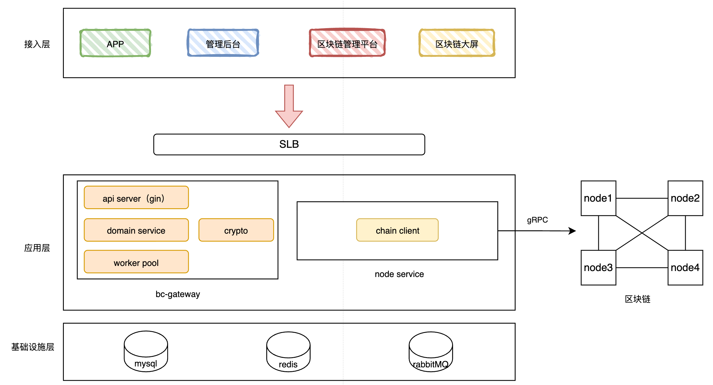
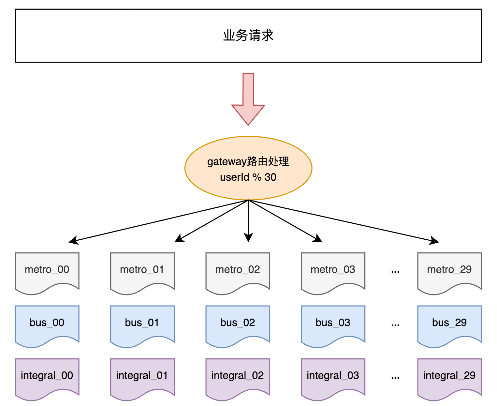
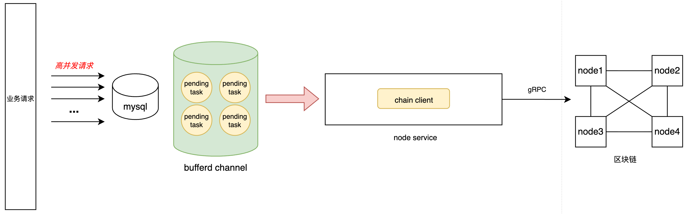

# 碳普惠系统的架构演进与一致性设计

**摘要：** 碳普惠系统需要协调出行数据核算、积分资产流转与区块链交易确认，其架构随业务职责和数据规模变化而调整。本文以基于 Go Gateway 与 ChainMaker 的系统实践为对象，分析存证服务、积分资产管理及数据与服务治理三个阶段的设计选择，讨论类 UTXO 模型、按用户分表、余额聚合和链访问服务拆分的适用条件与成本。在此基础上，提出异步任务状态管理、业务幂等、余额预留与对账的补充设计，并给出故障恢复约束及验证方法。

**关键词：** 碳普惠；类 UTXO；异步交易；幂等；余额投影；数据一致性

本文区分工程实践与设计分析：第 2—4 节描述已实施的主要架构变化；第 5 节提出一致性机制的补充方案，其有效性仍需结合具体实现与故障测试验证。数值算例仅用于说明状态变化，不作为生产压测结果。应用名称及部署细节已作泛化处理。

相关章节：[资产模型](#asset-model) · [异步交易处理](#223) · [余额一致性](#balance-consistency)。

## 1. 业务场景与系统边界

系统以绿色出行行为为输入，经行为校验与减排核算后发放碳积分，并支持积分流转和权益兑换。业务流程如下：

```text
绿色出行记录 → 行为校验与减排核算 → 碳积分发放 → 积分流转 → 权益兑换
```

Go Gateway 位于业务后台与 ChainMaker 联盟链之间，承担出行数据治理、积分业务处理和链交互职责。其设计涉及以下边界：

- **数据规模与交易规模。** 出行记录与链上交易不存在一一对应关系。一批记录可以参与一次核算，一次兑换也可能消费多个积分对象。本文的 1.2 亿级规模指地铁出行记录，不代表链上交易数量或吞吐率。
- **数据存证与来源真实性。** 摘要存证用于核验数据与存证时内容的一致性，不能独立证明出行行为真实发生。数据源校验、重复行为识别和核算规则仍由业务系统负责。
- **请求受理与交易确认。** 网关受理请求、节点接收交易和合约执行成功属于不同处理阶段，接口状态及业务展示应与各阶段的语义对应。

系统演进可划分为三个阶段：

| 阶段 | 设计目标 | 主要机制 | 约束与成本 |
| --- | --- | --- | --- |
| V1：存证 | 建立低碳行为数据的存证流程 | 单体 Gateway 集成 SDK，业务侧保留账户和核算逻辑 | 同步调用延迟，资产逻辑与存证逻辑分离 |
| V2：资产流转 | 支持积分发放、消费和来源追溯 | 类 UTXO 对象及消费关系 | 对象碎片、热点账户、合约确定性约束 |
| V3：数据与服务治理 | 应对数据增长及活动期间的访问压力 | 分表、余额表、异步处理、SDK 服务拆分 | 跨表统计、状态同步、任务恢复及运维成本 |

## 2. 存证阶段的系统设计（V1）

### 2.1 单体架构与职责划分

初期的积分计算与账户体系主要由业务后台承担。Gateway 负责摘要计算、交易构造、签名和 SDK 调用，HTTP 服务与链交互运行于同一进程。

链下数据库记录交易状态，链上合约提供类似 `save(hash)` 的存证接口。定时任务扫描待处理交易，执行重试或触发告警。

在开发与运维人员有限、SDK 封装变更频率较低的条件下，单体部署减少了代码库、部署单元及跨服务调用数量。该阶段的设计目标是建立数据接入、存证提交、交易记录与异常检测流程。

### 2.2 同步调用与补偿机制的局限

同步调用将签名、网络传输及链上等待时间纳入接口响应时间。下游处理延迟增加时，上游请求可能积压；提高 HTTP 并发上限不能直接提高区块链的处理能力。

补偿机制还需要区分执行失败与结果未知。请求超时可能发生在链上执行成功之后，此时再次提交并不一定安全。对于积分发放、扣减等具有资产变更效果的操作，补偿流程必须结合交易结果查询和幂等约束。

V1 降低了初始开发与部署成本，并保留了交易状态和异常处理入口，但其补偿机制不足以独立保障资产流转的一致性。

## 3. 资产流转阶段的数据模型（V2）

### 3.1 资产模型比较与选型 { #asset-model }

随着 Gateway 承接积分发放、流转和兑换，数据模型需要同时支持余额查询、来源识别和流转关系追溯。余额模型与类 UTXO 模型均可表达这些业务，主要差异在于来源关系的组织方式及维护成本。

| 维度 | 余额模型配合流水 | 类 UTXO 对象模型 |
| --- | --- | --- |
| 表达方式 | 账户余额及增减流水 | 带面额、归属和来源关系的积分对象 |
| 来源追溯 | 依赖完整流水与来源分配规则 | 沿对象的输入、输出关系追溯 |
| 余额读取 | 读取账户余额 | 聚合未消费对象，或维护余额投影 |
| 主要复杂度 | 流水完整性、余额更新与来源匹配 | 输入选择、找零、碎片及对象并发消费 |

系统采用类 UTXO 模型，将来源与消费关系直接纳入资产表示。该选择有利于表达对象级业务约束，同时增加了对象选择、状态维护和存储管理成本。余额模型也可以通过完整流水及来源分配规则实现追溯，因此可追溯性并非类 UTXO 独有的能力。

以下算例忽略手续费：用户持有面额分别为 6 和 4 的两个可消费对象，需要支付 7 个积分完成权益兑换。

```text
输入：A（6） + B（4）
              ↓ 同一笔有效消费
输出：平台收到 C（7） + 用户找零 D（3）

A、B 标记为已消费；C、D 保留到输入对象的来源关系。
普通流转满足：输入总额 = 输出总额。
```

对象消费表示状态由未消费转为已消费，历史记录仍需保留。发放与销毁属于改变积分总量的操作，应设置独立的授权和校验规则。积分面额应使用约定精度的整数单位，避免浮点误差影响金额守恒校验。

多输入交易还要求模型能够表达输入集合及其与输出的关联。单个 `ParentHash` 字段不足以表示一般情况下的多输入来源关系，来源追溯应建立在完整的交易输入、输出映射之上。

### 3.2 合约执行的确定性约束

系统开发过程中曾出现 Go `map` 遍历顺序影响合约执行结果的问题。产生不确定性的条件是：业务输出依赖集合的遍历次序，而该次序未被明确定义。

例如，按遍历顺序累计积分对象，并在金额达到目标值后终止选择，可能使不同执行次序产生不同输入集合。按遍历次序拼接摘要或分配输出编号也存在类似风险。Go 语言规范不保证 map 的迭代顺序。[Go 规范：range 语句](https://go.dev/ref/spec#For_statements_with_range_clause)

一种确定性的选择策略是：先按来源、有效期等业务条件过滤候选对象，再依据明确字段排序，并使用唯一标识消除同优先级对象之间的次序歧义。在相同状态与输入下，该策略应产生相同结果。

确定性问题与并发冲突需要分别处理。不同请求消费同一对象属于共享状态竞争；同一请求因遍历顺序不同而产生不同结果属于执行确定性问题。两者具有不同的触发条件和诊断方法。

### 3.3 热点账户与对象规模

权益兑换使积分持续流向平台账户，账户内累积了数百万个对象。针对该账户的大范围查询和交易构造增加了候选输入数量、读取范围及读写集规模，并出现交易超时问题。

全局历史记录增长与单账户对象集中是不同的负载特征。按用户分表可以分散不同用户的数据，但单个热点账户仍会集中在同一路由位置。

对象数量取决于发放次数、消费次数及每笔交易的输入输出数量。可考虑的治理措施包括限制单笔输入规模、按业务条件整理碎片、对平台收款账户分桶，以及使用独立余额投影承载展示查询。这些措施需要进一步验证：对象合并会增加交易负载，且必须保留来源、有效期和用途约束；后台合并还可能与用户消费发生竞争。

因此，资产模型评估应同时考虑来源追溯、高频消费和热点账户的处理成本，不能仅依据模型的表达能力作出判断。

## 4. 数据治理与服务解耦（V3）

V3 阶段将部分分散于业务后台与 Gateway 的碳业务集中至 Gateway。随着接入数据和用户规模增长，优化目标转向高频请求、数据访问范围及链交互延迟。



*图 1：V3 阶段的系统架构。Gateway 承担业务处理，节点服务封装链通信，MySQL 等组件提供数据存储与协调能力。*

### 4.1 按用户分表与跨表统计

地铁出行记录增长至约 1.2 亿条。系统在单表达到千万级规模时开始实施分表，采用 `userId % 30` 作为路由规则，使同一用户的数据分布于确定的表。

该分区方式与主要访问模式一致：用户出行查询和积分核算通常具有明确的用户条件，路由后可缩小单次访问的数据范围。索引仍需匹配实际过滤、排序与分页条件，分表不能替代索引设计。



*图 2：按用户标识路由的分表示意。1.2 亿量级对应地铁出行记录，各类业务表需分别评估。*

该方案增加了跨用户统计成本。运营与财务报表通常按时间范围聚合全部用户数据，需要跨表查询，并处理执行时间及统计口径一致性问题。

针对这一限制，可将在线查询与报表处理分离：在线链路服务于用户请求，统计链路按照明确的数据截止时间生成汇总，必要时使用独立分析存储。此处属于进一步的数据处理方案，不表示分表阶段已建设完整的数据仓库。

固定取模还具有扩容成本。分片数量调整会改变大量记录的路由位置，需要配套数据迁移、增量同步、路由切换及对账机制。30 张表是当时结合数据规模与维护成本确定的配置，不构成通用分片阈值。

### 4.2 基于余额投影的查询优化

活动页面产生高频余额查询。分表后，若仍逐次聚合用户的积分对象，查询计算量依然随对象数量增加。因此，系统引入 `balance` 表保存余额聚合结果。

该措施将余额读取由明细扫描与求和调整为按用户读取聚合记录，同时增加了投影维护责任。积分明细发生变化时，余额投影需要同步更新，并具备遗漏检测与差异修复能力。

余额表可视为面向查询的投影，与读写模型分离的设计思路一致。其作用是减少重复聚合，但单独引入聚合表不等同于实现完整的 CQRS 架构；同步延迟和一致性管理仍需单独设计。[Microsoft：CQRS 模式](https://learn.microsoft.com/en-us/azure/architecture/patterns/cqrs)

余额同步、预留与对账机制见[第 5.3 节](#balance-consistency)。

### 4.3 持久化任务与异步调度

签名、远程节点调用及交易确认的处理速率与业务请求到达速率存在差异。系统采用先持久化任务、再投递至缓冲 Channel 的处理流程，由 Worker 执行任务，并通过定时任务补偿未完成记录。



*图 3：持久化任务与进程内异步调度。缓冲队列位于内存，任务恢复依据为 MySQL 中的持久化记录。*

缓冲队列可吸收短时突发请求，减少接口对下游执行的同步等待。其容量有限，当任务持续到达速率超过消费速率时，队列与持久化任务均可能积压，因此需要联合控制受理速率、Worker 并发和下游负载。

异步处理的可靠性依赖持久化任务恢复、重复执行约束与结果查询机制。相关状态定义和故障处理条件在第 5 节中给出。

### 4.4 链访问服务的职责划分

早期 SDK 直接集成于 Gateway。随着链访问能力的复用需求增加，以及维护职责的细化，系统将 SDK 封装为独立节点服务。

拆分后，Gateway 负责核算、积分及业务任务，节点服务负责交易构造、提交、查询和链适配。两类服务可分别安排版本发布，其他上链应用也可复用节点服务接口。

独立部署增加了网络调用和分布式故障处理成本，包括超时、重试、接口版本兼容及跨服务诊断。接口和日志应关联业务标识与交易标识，以支持同一操作的链路追踪。

服务拆分的适用性取决于复用需求、变更频率和维护能力。对于人员有限且独立发布需求较弱的系统，额外代码库和服务实例的维护成本可能高于拆分收益。

## 5. 异步交易处理与链下状态一致性设计

本节基于既有的持久化任务、异步执行和余额聚合机制，提出接口语义、任务恢复及链下状态维护的补充设计。以下内容属于方案分析，不作为历史实现已具备相关能力的依据。

### 5.1 任务状态建模与故障恢复 { #223 }

**接口语义。** 异步接口应在业务意图与执行任务持久化成功后返回“已受理”，并提供可查询的业务单号。HTTP API 可使用 `202 Accepted` 表示受理状态，由查询接口或结果通知提供最终执行状态。

节点接收交易不等于合约执行成功。ChainMaker 文档区分异步提交与交易执行结果，可通过交易 ID 查询结果，或使用同步等待结果的接口。实现时应核对所用 SDK 版本的返回结构和状态码。[ChainMaker FAQ：交易执行与结果查询](https://docs.chainmaker.org.cn/v2.4.0/html/quickstart/FAQ.html)

**事务边界。** 若业务单与上链任务分别提交，可能出现业务单已持久化而任务未建立的状态。该方案要求在同一个本地数据库事务中写入业务单和待执行任务，提交成功后再通知 Worker。任务表可承担待发送记录的职责，无须以引入消息中间件作为前提。

这一设计对应 Transactional Outbox 模式：业务变更与待发送事件原子提交，外部投递独立执行并允许重试。该模式处理本地提交与外部发送之间的一致性问题，重复执行仍需幂等机制约束。[AWS：Transactional Outbox](https://docs.aws.amazon.com/prescriptive-guidance/latest/cloud-design-patterns/transactional-outbox.html)

**状态定义。** 任务状态及主要转换关系定义如下：

```text
PENDING → PROCESSING → CONFIRMING → SUCCEEDED
              │            │
              │            └─ 已确认的终态失败 → FAILED
              └─ 确定未执行且可重试 → RETRY_WAIT → PENDING

响应丢失或超时：进入 CONFIRMING，查询执行结果。
长期无法确认：转入人工核查，保留“结果未知”状态。
```

`PROCESSING` 应关联任务领取记录与租约。多实例通过条件更新等机制竞争任务，状态回写时校验领取版本，防止过期 Worker 覆盖新状态。租约到期表示允许其他 Worker 接管处理，不构成重新发放积分的依据；接管后仍需核查前次提交记录及链上结果。

为支持恢复，交易标识与提交尝试应在发送前持久化。若交易标识由节点服务生成，则该服务应支持通过稳定业务标识查询提交结果，避免唯一查询凭据仅存在于可能丢失的响应中。

不同故障位置对应的恢复依据与处理方式如下：

| 故障位置 | 恢复依据 | 处理方式 |
| --- | --- | --- |
| 本地事务提交前 | 尚无已受理业务 | 调用方使用同一业务键重试，不返回受理成功 |
| 提交后、入队前 | 业务单和待执行任务 | 扫描器恢复投递，重新通知 Worker |
| Worker 领取后、发送前 | 领取记录与提交准备信息 | 租约到期后接管；无法判断是否发送时按结果未知处理 |
| 发送后、结果返回前 | 业务键、交易标识 | 查询交易或业务执行记录，限制新交易提交 |
| 链上成功、本地回写前 | 链上结果与待确认任务 | 幂等回写成功状态，更新本地投影 |
| 重复通知或重复扫描 | 相同业务键和事件标识 | 返回已有结果，不重复增加或扣减积分 |

扫描范围应覆盖待执行、领取超时、待确认及可重试任务。已确定可重试的临时错误采用有上限的退避与抖动；参数非法、无权限等明确拒绝不应无限重试。超过处理预算后应告警并转入人工核查，但不得据此将未知结果直接标记为失败。

**过载控制。** 已持久化且处于受理容量范围内的任务，可保留待处理状态并由扫描器恢复投递；总积压超过容量预算时，应在受理新业务前实施限流或拒绝。为规避满队列而逐请求创建 goroutine，会扩大未受约束的内存并发，不能替代背压控制。

### 5.2 业务幂等约束

同一次出行积分发放可能因客户端重试、任务补偿和结果查询而被重复触发。每次尝试生成不同的随机请求 ID，无法识别其共同业务来源。因此，幂等约束需要覆盖业务入口、合约执行和结果消费三个环节。

1. **业务入口。** 在明确的业务命名空间内定义稳定键，例如发放类型与来源记录标识，或稳定的兑换单号。数据库通过唯一约束识别重复请求并返回已有业务单。同键但金额、用户或规则参数不同的请求应拒绝，并记录参数冲突。核算规则变更应采用显式补差流程，避免更换业务键造成重复发放。
2. **合约执行。** 授权校验、业务键检查、积分状态变更和执行结果保存应在一次原子执行中完成。重复请求仍需鉴权，幂等记录应绑定调用权限及关键参数的规范化摘要，同键不同参数应拒绝。业务键的命名空间和保存周期需覆盖历史任务可能被重放的范围。
3. **结果消费。** 事件处理标识与余额变更应在同一个本地数据库事务中提交。分别提交去重记录与余额更新，会在进程中断时产生漏记或重复记账风险。

交易 ID 标识一次链交互尝试，业务键标识一次积分操作。不同交易尝试可能属于同一业务，因此即使重试生成新的交易 ID，也应受同一业务键约束。新交易提交需满足结果核查和重试策略的条件。

原系统使用 Redis 锁协调部分多实例兑换请求。锁可减少并发处理，但不能替代业务幂等：持有者因暂停或慢调用超过有效期后，其他实例可能获得锁并开始执行。Redis 官方文档明确讨论了有效期与互斥保证的边界。[Redis：分布式锁](https://redis.io/docs/latest/develop/clients/patterns/distributed-locks/)

该方案允许重复投递和执行尝试，同时要求同一业务效果仅生效一次。此约束依赖数据库、合约及结果消费的共同实现，单一锁机制或队列机制不能独立构成端到端 exactly-once 保证。

### 5.3 余额投影、预留机制与对账流程 { #balance-consistency }

本方案以链上确认的积分变化作为资产结果依据，链下明细与余额作为可重建投影；尚未确认的兑换意图由业务单和预留记录表达。余额定义如下：

```text
confirmed_balance：已确认的有效余额
reserved_balance ：尚未完成的兑换预留
available_balance = confirmed_balance - reserved_balance
```

设已确认余额为 10，兑换金额为 7，忽略其他并发交易和额外消费限制，各阶段状态如下：

| 阶段 | 已确认余额 | 预留 | 可用余额 |
| --- | ---: | ---: | ---: |
| 兑换前 | 10 | 0 | 10 |
| 受理兑换并预留 | 10 | 7 | 3 |
| 链上成功且本地确认完成 | 3 | 0 | 3 |
| 或：确认业务不会执行后释放 | 10 | 0 | 10 |

预留操作应在同一本地事务中完成额度校验、条件更新、业务单和任务创建，防止多个请求依据同一旧余额分别通过检查。确认成功后，已确认余额扣减、对应预留释放、明细写入及消费标识记录也应原子提交。余额不足或账户版本变化时，应重新校验，不能无条件覆盖余额。

链调用超时时，预留应保持，业务单处于待确认状态。仅查询不到交易或等待超时，不足以证明业务不会执行。释放预留前，需要确认相关操作不会继续生效；存在多个提交尝试时，应核查各次尝试，或通过合约业务记录确定结果。

本地预留仅约束经过该入口的请求。若存在其他链上消费入口，需要统一协调，或根据链上校验拒绝结果修复本地状态。对于类 UTXO，还需校验来源、有效期、用途和消费状态，聚合余额满足金额要求并不代表候选对象必然满足消费条件。

**投影同步。** 本地状态可由链上结果查询或事件订阅推进。订阅事件采用链标识、交易及交易内事件位置去重，业务键用于关联任务。查询与订阅结果应进入同一业务确认流程，通过条件更新及唯一约束避免重复记账。用户投影应保持规定的处理顺序，或使用版本校验；涉及有效期和资格变化时，还需维护相应状态，不能仅按金额增量累计。断线补扫位置应持久化，并允许事件重复回放；消息确认应在本地事务提交后执行。

**对账流程。** 对账应统一数据范围、金额单位及确认进度，具体步骤如下：

1. 确定链上确认水位 `H`，并使本地投影处理至相应位置。比较状态快照时，需要历史查询能力，或将投影重建至同一水位，避免历史事件与实时余额之间的口径错配。
2. 比较截至 `H` 的链上业务记录与本地明细，按业务键定位遗漏、重复和状态差异。
3. 按相同资产类型、金额单位、有效期及账户范围重算明细余额，并与投影比较；预留单独核对至未结束业务单。
4. 隔离差异影响范围，通过幂等事件重放或有依据的投影修正恢复，并记录原因、依据及操作过程。重建时保留未决任务、预留和业务幂等记录，在独立投影版本中回放，为新版本维护独立消费去重记录；追平增量并核对一致后切换，避免旧消费标识跳过重建事件。

投影遗漏不应通过重新发放链上积分修复，否则可能产生重复资产。无法解释的差异应保留并核查，不应以直接覆盖余额代替原因分析。

### 5.4 故障场景与验证指标

验证应覆盖正常处理及故障恢复路径，包括本地事务提交后进程退出、链上执行成功但响应丢失、任务重复投递、Worker 租约过期、事件重复或乱序到达，以及交易确认前服务重启。

各场景应检验以下业务不变量：同一来源的同类积分不重复发放；已消费对象不再次消费；普通流转保持积分总量守恒；重复事件不改变已处理结果；所有已受理业务均存在可追踪的任务与处理记录。待处理或结果未知属于显式状态，不应表现为任务静默丢失。

性能观测应分别记录接口受理耗时、任务等待时间、提交至确认耗时、结果回写延迟和最老待处理任务年龄。HTTP QPS 不能单独反映异步任务积压或最终确认能力。上述内容构成验证方法与指标建议，本文未提供相应的生产压测结果。

## 6. 服务生命周期与运维约束

### 6.1 服务退出与任务恢复

原系统通过信号监听、停止入口及等待 Worker 完成任务改善发布过程。进一步的生命周期设计应明确退出顺序：先撤销就绪状态并停止领取新任务，再等待已受理请求结束，并为执行中任务设置有限的收尾时间。未完成任务应保留可恢复状态。

Go 的 `http.Server.Shutdown` 负责 HTTP 连接的优雅关闭，不管理应用中的全部后台 Worker；context 截止时间到达后，该调用返回错误，剩余收尾工作仍由应用负责。[Go：Server.Shutdown](https://pkg.go.dev/net/http#Server.Shutdown)

context 取消属于协作式通知，Worker 与下游调用需要主动响应，不能据此强制终止 goroutine。独立后台任务应采用服务级生命周期和单次执行超时，避免直接复用已结束请求的 context。[Go：context](https://pkg.go.dev/context)

持久化任务允许未完成操作在后续实例中继续查询或执行，因此退出前未排空所有任务不直接等价于资产丢失。发布期间的持续可用性还依赖多实例部署、流量摘除及版本兼容，不能由 `WaitGroup` 单独保证。

### 6.2 身份托管与数据隐私

Gateway 承担链上身份初始化、签名及证书管理职责，证书采用按需初始化方式，以减少不必要的创建与存储开销。

身份托管简化了客户端接入，同时将密钥保护责任集中至服务端。除加密存储外，完整的密钥管理还需覆盖访问控制、轮换、备份恢复及审计。

出行数据的链上披露范围应依据多方验证需求确定，优先保存必要业务结果或摘要。摘要不等同于匿名化：输入可枚举性、稳定身份关联及外部数据均可能增加识别风险。因此，原始轨迹、身份映射和查询权限需要分别控制。

### 6.3 增量写入优化与历史数据归档

针对节点存储增长，系统在新增数据侧采用业务允许范围内的调用合并、冗余世界状态削减和证书数据优化，在历史数据侧采用存储分层及归档工具。

各项措施对应不同的数据对象：交易负载优化影响后续增长，世界状态精简影响在线状态规模，历史区块归档影响历史数据的存放与读取。归档区块不意味着仍活跃的积分对象可从在线状态中移除。

存储分层需同时评估访问延迟、故障域、历史查询及恢复能力。批量提交也应限制单次规模，避免调用次数减少的同时扩大单次执行负载和失败重试成本。

## 7. 讨论与局限性

系统通过逐步调整数据模型、访问路径和服务职责完成三个阶段的演进。类 UTXO 将来源关系纳入资产表示；按用户分表缩小用户维度的访问范围；余额投影减少重复聚合；链访问服务拆分支持能力复用和独立维护。

这些机制均引入相应成本。类 UTXO 需要处理热点账户及碎片增长；余额投影需要同步、对账和重建机制；分表增加跨表统计与迁移复杂度；服务拆分增加远程调用及运维边界。方案适用性应结合业务访问模式、数据分布和维护能力评估。

本文分析主要依据架构变化与业务处理过程，未提供统一条件下的前后对照实验。因此，相关结论限于职责划分、处理机制及故障约束分析，不用于推断具体性能提升幅度。一致性补充方案仍需通过实现审查、故障注入和持续对账验证。

后续工作包括明确链上资产结果、链下业务意图与余额投影之间的权威边界，评估不同积分业务对对象模型的实际需求，以及在既有恢复机制基础上研究出行隐私保护、多方验证和跨链协作。
