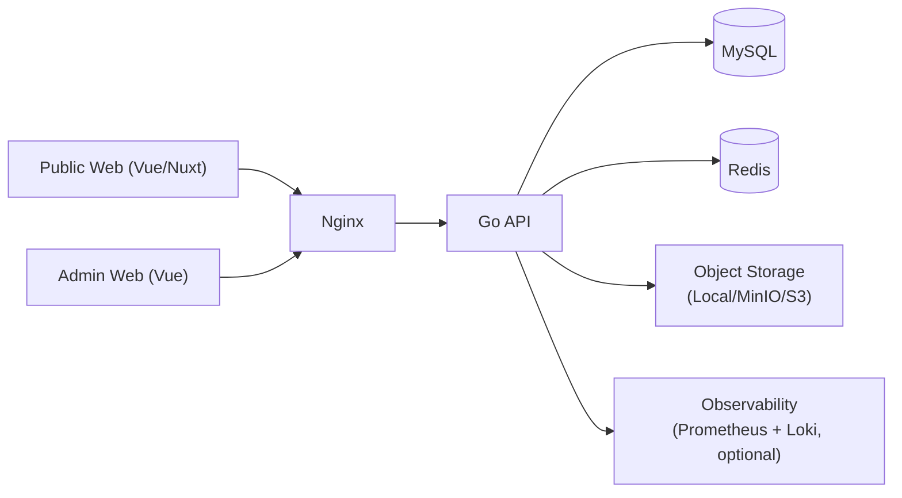

# 03. 博客系统前后端分离总体设计

## 1. 背景与目标

当前博客基于 `MkDocs + Markdown + GitHub Pages`，发布流程简单、稳定，但存在以下限制：

- 内容管理依赖本地文件与 Git 提交；
- 缺少后台管理能力（草稿、定时发布、回收站等）；
- 难以承载后续动态能力（评论、点赞、搜索推荐、用户体系）；
- 运维形态偏静态站点，不利于部署到自有服务器做业务扩展。

本次演进目标：

- 从静态博客升级为前后端分离架构；
- 后端统一使用 Go 开发，优先保证可维护性与可扩展性；
- 前端在你“经验较少”的前提下，选择学习成本低、开发效率高的方案；
- 支持本地服务器和云服务器两种部署方式；
- 保留现有 Markdown 内容资产，避免一次性重写历史文章。

非目标（第一阶段不做）：

- 微服务拆分；
- 复杂推荐系统；
- 多租户/团队协作 CMS。

---

## 2. 总体方案（一句话）

采用 **单体后端 API + 前端 Web（公共站点）+ 管理后台（可选同仓）** 的前后端分离模式：

- 后端作为唯一业务入口（认证、内容、标签、发布、统计）；
- 前端通过 REST API 获取数据并渲染页面；
- 数据层使用 MySQL，缓存与会话使用 Redis；
- 对象文件（图片）走本地目录或 MinIO/S3；
- 用 Docker Compose 统一本地与云端部署形态。

---

## 3. 架构设计

### 3.1 逻辑架构



### 3.2 部署架构（推荐）

- `nginx`：反向代理、静态资源托管、HTTPS 终止。
- `web`：前端应用（Public/ Admin）。
- `api`：Go 服务。
- `mysql`：核心业务数据。
- `redis`：缓存、限流、会话黑名单。
- `minio`（可选）：图片/附件对象存储。

### 3.3 演进原则

- 先单体后拆分：先把 API 边界定义清晰，再考虑微服务。
- 先可用再完美：优先跑通文章发布与读取主链路。
- 兼容存量：第一阶段支持 Markdown 导入，减少迁移风险。

---

## 4. 技术选型

### 4.1 后端（Go）

推荐技术栈：

- Go: `1.23+`
- Web 框架: `gin`
- ORM: `gorm`
- 鉴权: `JWT + Refresh Token`
- 数据库: `MySQL 8`
- 缓存: `Redis`
- 配置: `viper`
- 日志: `zap`
- 迁移: `golang-migrate`
- 接口文档: `OpenAPI/Swagger`

选择理由：

- 上手快，生态成熟，适合单人/小团队持续迭代；
- 先用 GORM 提高开发速度，后续热点查询可替换为手写 SQL。

### 4.2 前端（建议你优先这个）

推荐：`Vue 3 + TypeScript + Vite + Pinia + Vue Router`

- 学习曲线相对平滑，中文资料丰富；
- 管理后台和博客站点都能覆盖；
- 与后端 REST API 解耦明确。

可选增强：

- 公共博客若强调 SEO，可将 Public Web 升级为 `Nuxt 3`（SSR/SSG）。

---

## 5. 核心领域与数据模型

### 5.1 领域划分

- 认证域：登录、Token 刷新、权限校验。
- 内容域：文章、分类、标签、草稿、发布。
- 媒体域：图片上传、压缩、引用。
- 互动域（二期）：评论、点赞。
- 观测域：访问统计、健康检查、审计日志。

### 5.2 核心表（最小闭环）

- `users`
- `posts`
- `categories`
- `tags`
- `post_tags`
- `media_files`
- `audit_logs`

关键字段建议：

- `posts`: `id`, `title`, `slug`, `summary`, `content_md`, `content_html`, `status(draft/published/archived)`, `cover_url`, `published_at`, `created_at`, `updated_at`, `deleted_at`
- `users`: `id`, `username`, `password_hash`, `role(admin/editor)`, `last_login_at`, `created_at`
- `media_files`: `id`, `filename`, `url`, `mime_type`, `size`, `sha256`, `created_at`

索引建议：

- `posts(slug)` 唯一索引；
- `posts(status, published_at desc)` 复合索引；
- `post_tags(post_id, tag_id)` 唯一索引。

---

## 6. API 设计（V1）

接口前缀：`/api/v1`

公共接口：

- `GET /posts`：分页获取已发布文章；
- `GET /posts/{slug}`：按 slug 获取文章详情；
- `GET /categories`、`GET /tags`；
- `GET /healthz`：健康检查。

管理接口（需登录）：

- `POST /auth/login`
- `POST /auth/refresh`
- `POST /posts`、`PUT /posts/{id}`、`DELETE /posts/{id}`
- `POST /posts/{id}/publish`
- `POST /media/upload`
- `GET /admin/stats/overview`

统一响应规范：

- 成功：`{ code: 0, message: "ok", data: ... }`
- 失败：`{ code: <业务码>, message: <错误信息>, request_id: ... }`

---

## 7. 内容迁移方案（从现有 MkDocs 演进）

### 7.1 一次性导入

- 解析 `docs/posts/**/*.md`；
- 提取标题、摘要、正文、发布时间；
- 生成 slug 并入库到 `posts`；
- 图片路径从相对路径映射到对象存储 URL。

### 7.2 双轨期（推荐 2-4 周）

- 保留原静态博客在线；
- 新站点接同一域名子路径或二级域名灰度；
- 对比 SEO、性能和内容完整性后切换。

---

## 8. 安全与稳定性设计

- 密码存储：`bcrypt`；
- 登录保护：失败次数限制 + IP 限流（Redis）；
- 接口安全：JWT 过期 + Refresh 轮换；
- 权限模型：RBAC（`admin/editor`）；
- 审计日志：记录后台关键操作（发布、删除、权限变更）；
- 备份策略：MySQL 每日备份 + 对象存储生命周期策略。

---

## 9. 部署与运维

### 9.1 本地服务器部署

- Docker Compose 一键启动：`nginx + web + api + mysql + redis + minio`。
- 使用 `Caddy` 或 `Nginx + Certbot` 自动 HTTPS。

### 9.2 云服务器部署

- 最小配置建议：`2C4G`（个人博客够用）；
- 对象存储可替换为云厂商 OSS/COS/S3；
- 数据库可先自建 MySQL，后续迁移托管 RDS。

### 9.3 CI/CD（GitHub）

- `push main` 触发：测试 -> 构建镜像 -> 推送镜像仓库 -> SSH 拉起新版本；
- 生产部署采用“先拉镜像、后重启单服务”的最小中断策略。

---

## 10. 分阶段实施计划

### Phase 0：设计冻结（1 周）

- 输出 API 文档、ER 图、目录结构、部署脚本草稿。

### Phase 1：后端 MVP（2 周）

- 完成认证、文章 CRUD、发布、列表查询、Markdown 渲染。

### Phase 2：前端 MVP（2 周）

- 完成公共博客首页、文章页、标签分类页；
- 完成后台登录、文章编辑、发布页面。

### Phase 3：迁移与上线（1 周）

- 历史文章导入；
- 域名切换；
- 监控与备份验证。

### Phase 4：增强能力（持续）

- 评论系统、站内搜索、草稿自动保存、访问统计面板。

---

## 11. 建议的仓库结构（重构后）

```text
.
├── apps
│   ├── api/                # Go 后端
│   └── web/                # Vue 前端（Public + Admin）
├── deploy
│   ├── docker-compose.yml
│   ├── nginx.conf
│   └── .env.example
├── scripts
│   ├── migrate.sh
│   └── import_markdown.go
└── docs
    └── posts/...
```

---

## 12. 风险与应对

- 风险：前端学习曲线导致进度不稳定。
- 应对：先交付后端 API + Swagger，再按页面优先级逐步实现前端。

- 风险：Markdown 历史内容格式不统一。
- 应对：导入脚本支持失败重试与人工映射表。

- 风险：单机部署下数据丢失。
- 应对：备份自动化 + 定期恢复演练。

---

## 13. 下一步落地建议

1. 先冻结 V1 API 和数据模型（避免后续前后端反复改协议）。
2. 在当前仓库新增 `apps/api`，先实现后端 MVP。
3. 我会基于本设计继续给你输出“后端项目脚手架 + 首批接口实现 + Docker Compose”。
